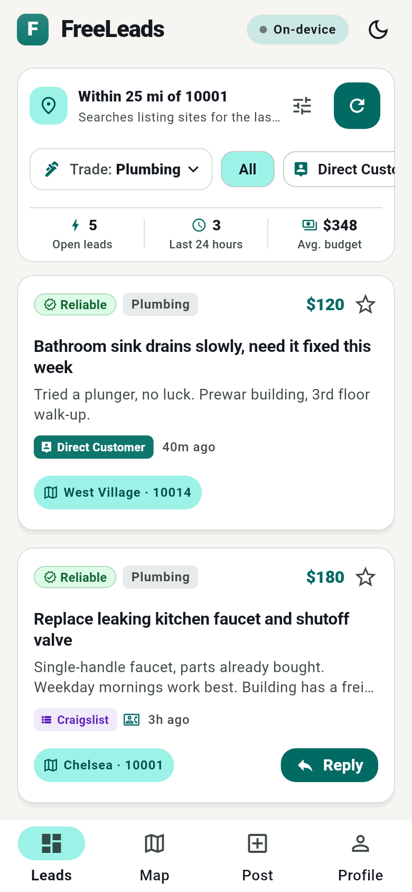
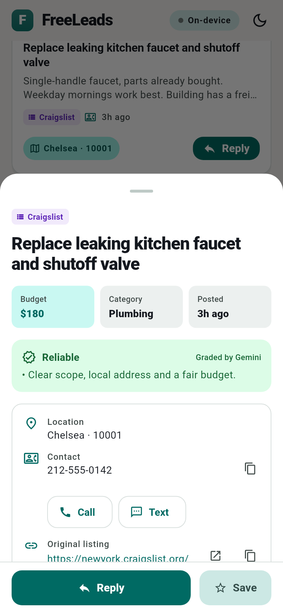
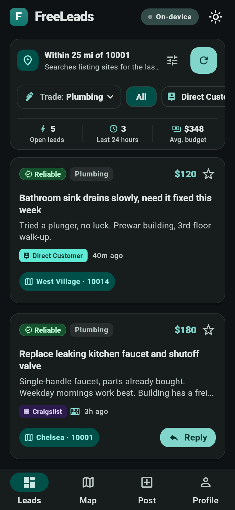
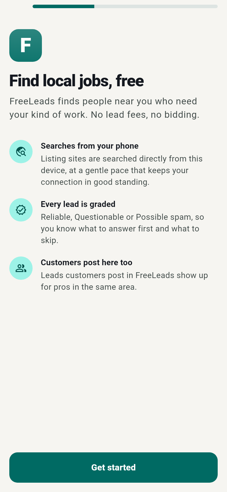

# FreeLeads

FreeLeads is a Flutter app I made for people who do trade work (plumbing,
electrical, cleaning, moving, etc.) to find local jobs without paying a lead
broker. You pick your trade, ZIP code and how far you're willing to drive,
and the app shows job requests near you. Customers can also post jobs
directly in the app.

## What it does

- Shows a feed of job requests for your trade and area, with favorites
- Lets customers post jobs, which sync to nearby users through Firestore
- Flags sketchy posts (gift card payments, up-front fees, "text me on
  WhatsApp", etc.) so you can skip them
- Map view of leads, with light and dark mode
- Works offline: leads and settings are saved on the device, and posts made
  offline upload once you're back online

## Tech stack

- **Flutter** and **Dart**
- **Firebase**: Authentication (anonymous + Google) and Cloud Firestore
- **Hive** for local storage
- **flutter_map** with OpenStreetMap tiles

## Screenshots

| Feed | Lead details | Dark mode | Onboarding |
| --- | --- | --- | --- |
|  |  |  |  |

## Running it locally

You'll need the [Flutter SDK](https://docs.flutter.dev/get-started/install)
and your own Firebase project. My Firebase config isn't in the repo, so the
app won't connect to a backend until you add yours.

1. Clone the repo and install packages:

   ```sh
   git clone https://github.com/finefair55-create/freeleads.git
   cd freeleads
   flutter pub get
   ```

2. Connect your Firebase project. The easiest way is the FlutterFire CLI:

   ```sh
   dart pub global activate flutterfire_cli
   flutterfire configure
   ```

   Or copy the templates and fill in the values from your Firebase console:

   ```sh
   cp lib/firebase_options.example.dart lib/firebase_options.dart
   cp android/app/google-services.example.json android/app/google-services.json
   ```

3. In the Firebase console, turn on **Anonymous** and **Google** sign-in,
   then deploy the Firestore rules:

   ```sh
   firebase use --add
   firebase deploy --only firestore
   ```

4. Run it:

   ```sh
   flutter run
   ```

If Firebase isn't set up, the app still opens, but posted jobs only stay on
your device.

Optional: a Gemini API key gives better parsing of listing text. Put it in
`secrets.json` (see `secrets.example.json`) and run with
`flutter run --dart-define-from-file=secrets.json`, or paste it in the
Profile tab. Without it, the app falls back to keyword filtering.

## Tests

```sh
flutter analyze
flutter test
```

## Notes

- The Craigslist source is just a demo. Their terms don't allow scraping,
  so check a site's rules before using it as a source.
- ZIP code locations come from public US Census data, so no geocoding API
  is needed.
